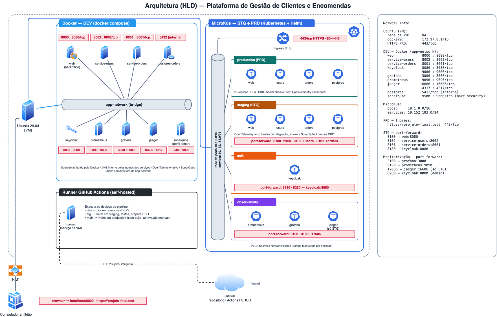

# Plataforma de Gestão de Clientes e Encomendas

Solução de gestão de clientes e encomendas baseada em microsserviços, com entrega contínua em três ambientes (DEV, STG e PRD), autenticação centralizada e monitorização integrada.

O presente documento descreve a solução e o procedimento de instalação, utilização e manutenção em cada ambiente.

- [1. Descrição da solução](#1-descrição-da-solução)
- [2. Arquitetura](#2-arquitetura)
- [3. Pré-requisitos](#3-pré-requisitos)
- [4. Instalação e execução](#4-instalação-e-execução)
- [5. Acessos e credenciais](#5-acessos-e-credenciais)
- [6. Utilização do site de gestão](#6-utilização-do-site-de-gestão)
- [7. Monitorização](#7-monitorização)
- [8. Paragem e limpeza](#8-paragem-e-limpeza)
- [9. Resolução de problemas](#9-resolução-de-problemas)
- [10. Referência técnica](#10-referência-técnica)
- [11. Considerações para utilização em produção real](#11-considerações-para-utilização-em-produção-real)

---

## 1. Descrição da solução

A plataforma destina-se a organizações que necessitam de registar os seus clientes e as respetivas encomendas. Disponibiliza:

- um **site de gestão** (backoffice), no qual os funcionários criam, consultam, editam e apagam clientes e encomendas;
- uma **API REST**, com respostas em JSON, que permite a integração com outras aplicações (loja online, aplicação móvel).

### Benefícios

| Benefício | Como é assegurado |
|---|---|
| Entregas rápidas e controladas | Cada alteração é analisada, testada e publicada automaticamente pela ordem DEV → STG → PRD. A versão que chega a produção é exatamente a que foi validada em STG |
| Disponibilidade e escalabilidade | Em produção, cada serviço executa com um mínimo de duas réplicas e escala automaticamente em função da carga |
| Proteção dos dados | Em produção existe um único ponto de entrada, em HTTPS, e todas as operações exigem autenticação e a permissão adequada |
| Deteção precoce de problemas | Análise de vulnerabilidades do código, das dependências e das imagens antes de cada entrega; métricas e alertas em tempo real; rastreio de pedidos entre serviços em DEV e STG |
| Reprodutibilidade | Cada ambiente é criado com dois comandos e totalmente removido com um |

### Ambientes

| Ambiente | Plataforma | Finalidade |
|---|---|---|
| **DEV** | Docker Compose | Desenvolvimento, testes unitários e testes de vulnerabilidades do código |
| **STG** | Kubernetes (MicroK8s), *namespace* `staging` | Validação: testes de integração, *smoke* e de vulnerabilidades do código. Tudo o que PRD utiliza (imagens e certificado) é construído e gerado aqui, e apenas o que é aprovado segue para produção |
| **PRD** | Kubernetes (MicroK8s), *namespace* `production` | Exploração, em HTTPS. Nada é construído nem gerado neste ambiente e não se executam testes: apenas se sobe o que STG preparou e validou |

---

## 2. Arquitetura



O diagrama editável encontra-se em `docs/hld.drawio`. O processo de implementação, as decisões de design e as ferramentas e bibliotecas utilizadas estão descritos no documento `Passo 8.md`, entregue juntamente com o projeto.

| Componente | Função |
|---|---|
| **web** | Site de gestão, servido por nginx |
| **service-users** | API de clientes (FastAPI) |
| **service-orders** | API de encomendas (FastAPI); valida cada cliente junto do `service-users` |
| **PostgreSQL** | Base de dados, com armazenamento persistente |
| **Keycloak** | Autenticação e autorização (OIDC/JWT) |
| **Prometheus** | Recolha de métricas |
| **Grafana** | Painéis e alertas |
| **Jaeger** | Rastreio distribuído (OpenTelemetry), apenas em DEV e STG |
| **SonarQube** | Análise de vulnerabilidades do código Python (servidor local em Docker) |

Em STG e PRD, o Keycloak e as ferramentas de monitorização residem em *namespaces* próprios (`auth` e `observability`) e são partilhados pelos dois ambientes.

---

## 3. Pré-requisitos

| Ambiente | Requisitos |
|---|---|
| DEV | Docker com Compose v2 (`docker compose` ou `docker-compose`), `make`, `curl` e Python 3.12 ou superior com o módulo `venv` (validado em 3.12 e 3.14). O SonarQube, iniciado por `make security`, necessita de cerca de 2 GB de memória livre |
| STG e PRD | Os anteriores, MicroK8s, Helm, `openssl` e `fuser` (pacote `psmisc`, em Linux) |

Preparação do MicroK8s (uma única vez):

```bash
sudo snap install microk8s --classic
```

```bash
sudo microk8s enable dns hostpath-storage metrics-server
```

Em sistemas sem MicroK8s (macOS ou Windows), a solução executa igualmente num cluster [kind](https://kind.sigs.k8s.io/), criado com `kind create cluster --name dev`. O `Makefile` deteta automaticamente o cluster disponível e os comandos são os mesmos; a única diferença reside no acesso a PRD (secção 4.3).

Obtenção do projeto:

```bash
git clone git@github.com:Kunami264/projeto-final-devops.git
```

```bash
cd projeto-final-devops
```

---

## 4. Instalação e execução

Todas as operações são realizadas através do `make`. Cada ambiente segue a mesma sequência:

```text
DEV:  make build-dev → make run-dev → make test-dev
STG:  make build-stg → make run-stg → make test-stg
PRD:  make run-prd
```

A lista completa de comandos é apresentada por `make help`.

### 4.1 DEV

| Passo | Comando | Resultado |
|---|---|---|
| 1. Construção | `make build-dev` | Cria o ambiente virtual Python (`.venv`) e constrói as imagens Docker |
| 2. Arranque | `make run-dev` | Inicia todos os serviços e apresenta os endereços e as credenciais |
| 3. Testes | `make test-dev` | Executa os testes unitários e os testes de vulnerabilidades do código (SonarQube) |
| 4. Demonstração (opcional) | `make demo-dev` | Autentica-se e cria, edita e apaga um cliente e uma encomenda |
| 5. Paragem | `make stop-dev` | Para os serviços, mantendo os dados |

Após o arranque, o site de gestão fica disponível em <http://localhost:8000>.

### 4.2 STG

STG é o ambiente onde tudo é construído, gerado e validado. Só o que é aprovado aqui segue para PRD.

| Passo | Comando | Resultado |
|---|---|---|
| 1. Construção | `make build-stg` | Constrói as imagens com todas as dependências de produção instaladas, carrega-as no cluster, gera o certificado TLS de PRD e instala no `.venv` os módulos de teste |
| 2. Arranque | `make run-stg` | Instala o Keycloak, as ferramentas de monitorização, o Ingress controller e a aplicação |
| 3. Validação | `make test-stg` | Executa os testes de integração, *smoke* e de vulnerabilidades do código. Se forem aprovados, prepara PRD: promove as imagens (`stg` → `main`, sem novo *build*) e instala o certificado TLS no cluster. `make integration-stg` executa apenas os testes de integração e *smoke*, sem preparar PRD |
| 4. Demonstração (opcional) | `make demo-stg` | Cria, edita e apaga um cliente e uma encomenda |

STG não é exposto para o exterior do cluster. O acesso faz-se por *port-forward*, mantendo em execução num terminal:

```bash
make forward-stg
```

O site de gestão fica então disponível em <http://localhost:8100>.

### 4.3 PRD

Em produção nada é construído nem gerado e não se executam testes: apenas se sobe o ambiente com as imagens e o certificado preparados e validados em STG. O arranque é rápido e executa exatamente o que foi testado. O rastreio distribuído (OpenTelemetry) não está ativo em PRD.

| Passo | Comando | Resultado |
|---|---|---|
| 1. Arranque | `make run-prd` | Confirma que STG preparou PRD (imagens, certificado e Keycloak) e sobe a aplicação com o ponto de entrada HTTPS. Se faltar algum pré-requisito, termina com erro e indica os passos de STG a executar |
| 2. Verificação | `make status-prd` | Apresenta as réplicas, os *health-checks*, o escalonamento automático e o Ingress |
| 3. Publicação (opcional) | `make push-prd` | Publica no registo (GHCR) as imagens promovidas por STG |

O site responde no endereço `projeto-final.test`, que deve ser associado à máquina do cluster (uma única vez):

```bash
echo '127.0.0.1 projeto-final.test' | sudo tee -a /etc/hosts
```

O site de gestão fica disponível em <https://projeto-final.test/>. Os pedidos em HTTP são redirecionados para HTTPS. O certificado gerado é autoassinado, pelo que o navegador apresenta um aviso na primeira visita.

Em cluster kind, o ponto de entrada não ocupa a porta 443 da máquina: é necessário manter em execução `make forward-prd` e utilizar <https://projeto-final.test:8443/>.

A disponibilidade em produção é assegurada pelos *health-checks* do Kubernetes (*readiness* e *liveness*), pelo número mínimo de réplicas e pelo escalonamento automático.

---

## 5. Acessos e credenciais

Sempre que é solicitada autenticação: utilizador **`admin`**, palavra-passe **`admin`**.

| | DEV | STG | PRD |
|---|---|---|---|
| **Condição prévia** | `make run-dev` | `make forward-stg` (site) e `make forward-infra` (ferramentas) | `make forward-infra` (apenas para as ferramentas) |
| **Site de gestão** | <http://localhost:8000> | <http://localhost:8100> | <https://projeto-final.test/> |
| **Grafana** | <http://localhost:3000> | <http://localhost:3100> | <http://localhost:3100> |
| **Prometheus** | <http://localhost:9090> | <http://localhost:9190> | <http://localhost:9190> |
| **Jaeger** | <http://localhost:16686> | <http://localhost:17686> | — (sem rastreio em PRD) |
| **Keycloak** (administração) | <http://localhost:8080> | <http://localhost:8280> | <http://localhost:8280> |
| **SonarQube** | <http://localhost:9500> | <http://localhost:9500> | — |

- O site de gestão, o Grafana, o Keycloak e o SonarQube exigem autenticação. O SonarQube é iniciado por `make security` (ou `make sonar-up`) e usa o utilizador **`admin`** com a palavra-passe **`ProjetoFinal.2026`**, definida na primeira execução. O Prometheus e o Jaeger não dispõem de ecrã de autenticação.
- Em STG e PRD, as ferramentas de monitorização e a administração do Keycloak não são expostas para o exterior do cluster; o acesso faz-se exclusivamente através de `make forward-infra`. Por serem partilhadas, os endereços coincidem nos dois ambientes.
- As credenciais indicadas são de demonstração e devem ser alteradas antes de qualquer utilização com dados reais (secção 11).

---

## 6. Utilização do site de gestão

O funcionamento é idêntico nos três ambientes; apenas o endereço difere (secção 5).

### 6.1 Autenticação

Introduzir o utilizador e a palavra-passe e selecionar **Entrar**. A sessão mantém-se enquanto a página estiver aberta; fechar ou recarregar a página termina a sessão.

### 6.2 Clientes

No separador **Clientes**:

| Operação | Procedimento |
|---|---|
| Criar | Selecionar **Novo cliente**, preencher *Nome* e *Email* e **Guardar** |
| Editar | Selecionar **Editar** na linha do cliente, alterar os dados e **Guardar** |
| Apagar | Selecionar **Apagar** na linha do cliente e confirmar |

Não são admitidos dois clientes com o mesmo endereço de email.

### 6.3 Encomendas

No separador **Encomendas**:

| Operação | Procedimento |
|---|---|
| Criar | Selecionar **Nova encomenda**, escolher o *Cliente*, preencher *Artigo* e *Quantidade* e **Guardar** |
| Editar | Selecionar **Editar** na linha da encomenda, alterar o artigo ou a quantidade e **Guardar** |
| Apagar | Selecionar **Apagar** na linha da encomenda e confirmar |

A criação de uma encomenda exige a existência de pelo menos um cliente. O cliente associado a uma encomenda não é alterável após a criação.

### 6.4 Persistência dos dados

Os clientes e as encomendas são guardados numa base de dados PostgreSQL com armazenamento persistente, pelo que se mantêm após o reinício dos serviços ou a atualização da aplicação.

- Cada ambiente dispõe da sua própria base de dados. Os dados criados em DEV não existem em STG nem em PRD, o que garante que os testes nunca afetam os dados de produção.
- Os comandos `make stop-dev`, `make stop-stg` e `make stop-prd` preservam os dados.
- Apenas os comandos `make clean...` eliminam os dados; no arranque seguinte são repostos três clientes de exemplo.

### 6.5 Contas de acesso

Os clientes registados no site são os clientes da organização. As contas das pessoas autorizadas a aceder ao site são geridas no Keycloak:

1. Aceder à administração do Keycloak (secção 5) e autenticar-se.
2. Selecionar o *realm* **projeto-final**.
3. Em *Users*, selecionar *Add user*, indicar o *Username* e confirmar com *Create*.
4. No separador *Credentials*, selecionar *Set password*, desativar *Temporary* e guardar.

A palavra-passe de uma conta existente é alterada no mesmo local, em *Credentials* → *Reset password*.

---

## 7. Monitorização

Para que existam dados, deve utilizar-se previamente o site ou executar `make demo-dev` algumas vezes.

| Ferramenta | Procedimento | Informação disponível |
|---|---|---|
| **Grafana** | *Dashboards* → *service-users / service-orders — visão geral* | Pedidos por segundo, taxa de erros, tempos de resposta (mediana e percentil 95) e pedidos por operação. Em *Alerting* → *Alert rules* encontram-se três alertas: taxa de erros elevada, respostas lentas e serviço indisponível |
| **Prometheus** | *Status* → *Targets* | Estado da recolha de métricas; os dois serviços devem apresentar o estado `UP` |
| **Jaeger** (DEV e STG) | Selecionar o serviço `service-orders` e *Find Traces* | Percurso de cada pedido entre os dois serviços, com a duração de cada etapa e a identificação de erros |

Exemplo de consulta no Prometheus:

```text
sum(rate(http_requests_total[5m])) by (service)
```

---

## 8. Paragem e limpeza

| Comando | Efeito |
|---|---|
| `make stop-dev`, `make stop-stg`, `make stop-prd` | Para o ambiente, preservando os dados e as imagens |
| `make clean-dev` | Limpeza Docker completa: `docker compose down -v --rmi all --remove-orphans`, paragem de todos os contentores, `docker system prune -af --volumes`, `volume prune`, `network prune` e `builder prune`; remove ainda o `.venv` e os ficheiros temporários e apresenta `docker system df`. **Elimina os dados** |
| `make clean-stg` | Remove a aplicação e o *namespace* `staging`, todas as imagens do projeto (no cluster e no Docker) e o certificado gerado em STG. **Elimina os dados** |
| `make clean-prd` | Remove a aplicação, o *namespace* `production`, o Ingress do Keycloak, o Secret TLS e a entrada `projeto-final.test` do `/etc/hosts`. **Elimina os dados** |
| `make clean-infra` | Remove o Keycloak, a monitorização, o Ingress controller, o RBAC de cluster do Prometheus e as imagens de terceiros carregadas no cluster |
| `make sonar-down` | Para o SonarQube, preservando as análises |
| `make clean-sonar` | Remove o SonarQube: contentor, volumes (análises) e imagem |
| `make clean` | Executa todas as limpezas anteriores e remove os ficheiros de acesso ao cluster (`kubeconfig-*.yaml`) e os *port-forwards* ativos |

Após `make clean` não subsiste qualquer recurso do projeto no cluster nem na máquina; permanece apenas o MicroK8s instalado. **Atenção:** `make clean-dev` (incluído em `make clean`) para e remove todos os contentores, imagens e volumes Docker da máquina, e não apenas os deste projeto. Em cluster kind, o nó do cluster é preservado. A remoção da entrada do `/etc/hosts` pede a palavra-passe de administrador.

---

## 9. Resolução de problemas

| Mensagem | Causa | Resolução |
|---|---|---|
| `Não foi possível obter o kubeconfig do cluster` | O MicroK8s não está instalado ou não arrancou | Os comandos `make` arrancam automaticamente o MicroK8s quando está parado e apresentam o erro devolvido. Se não estiver instalado: `sudo snap install microk8s --classic` |
| `PRD não está preparado` ao executar `make run-prd` | Os passos de STG não foram executados | `make build-stg`, `make run-stg` e `make test-stg` |
| `kubernetes cluster unreachable` ao utilizar o `helm` diretamente | O Helm não tem indicação do cluster a utilizar | Executar `make kubeconfig` e acrescentar `--kubeconfig kubeconfig-make.yaml` ao comando. Os comandos `make` fazem-no automaticamente |
| `UPGRADE FAILED: "projeto-final" has no deployed releases` | Uma instalação anterior foi interrompida | Os comandos `make run-stg` e `make run-prd` e o pipeline removem automaticamente a instalação incompleta |
| `Credenciais do SonarQube recusadas` | A palavra-passe do SonarQube foi alterada manualmente no painel | `make security SONAR_PASSWORD=<palavra-passe atual>`, ou `make clean-sonar` para recriar o servidor |
| `401 Unauthorized` na autenticação, após atualizar o projeto | O Keycloak mantém as contas e permissões da versão anterior | `make reset-keycloak` no cluster; em DEV, `make clean-dev` e novo arranque |

O Keycloak apenas importa as contas e permissões iniciais (`k8s/auth/realm-export.json`) no primeiro arranque. O comando `make reset-keycloak` repõe essa configuração e elimina as contas criadas manualmente.

---

## 10. Referência técnica

### 10.1 Dependências Python por ambiente

| Ficheiro | Ambiente | Conteúdo |
|---|---|---|
| `requirements-prd.txt` | PRD | Apenas as dependências de execução. É o único conjunto instalado nas imagens Docker |
| `requirements-stg.txt` | STG | Módulos de teste e de análise (`pytest`, `httpx`, `pysonar`) para os testes de integração, *smoke* e de vulnerabilidades |
| `requirements-dev.txt` | DEV | Reúne os dois anteriores |

Cada serviço dispõe de `requirements-prd.txt` (instalado pelo respetivo `Dockerfile`) e de `requirements-dev.txt`. O ambiente virtual é criado com `python -m venv .venv` pelos comandos `build-dev` e `build-stg`.

A imagem é construída uma única vez, em `build-stg`, com as dependências de produção. Os módulos de teste permanecem no `.venv`, fora da imagem. `test-stg`, se os testes forem aprovados, promove a mesma imagem (`stg` → `main`) e `run-prd` limita-se a iniciá-la.

### 10.2 Testes

| Tipo | Ambiente | Localização | N.º |
|---|---|---|---|
| Unitários | DEV | `service-users/tests` | 23 |
| Unitários | DEV | `service-orders/tests` | 19 |
| Integração | STG | `tests/integration` | 12 |
| *Smoke* | STG | `tests/smoke` | 3 |
| **Total** | | | **57** |

Os testes de vulnerabilidades complementam os anteriores: o **SonarQube** analisa o código Python (`make security`, incluído em `make test-dev` e `make test-stg`) e o **Trivy** analisa as dependências e as imagens no pipeline.

O `make security` inicia um SonarQube local em Docker (serviço `sonarqube` do `docker-compose.yml`, no *profile* `sonar`, que o `make run-dev` não arranca), aplica o *quality gate* **Segurança** e analisa o código com o `pysonar`. O comando falha se existir qualquer problema de segurança no código; os problemas de manutenção ficam registados no painel, sem bloquear. Uma linha assinalada com `# NOSONAR` é excluída da análise, o que se aplica apenas a situações intencionais (a opção `--insecure` de `scripts/demo.py`, para o certificado autoassinado de PRD). `make sonar-down` para o servidor, mantendo as análises; `make clean-sonar` remove-o.

### 10.3 Pipeline de entrega contínua

O pipeline (`.github/workflows/pipeline.yml`, GitHub Actions) acompanha a promoção entre os ramos `dev`, `stg` e `main`:

| Ramo | Etapas |
|---|---|
| `dev` | Testes de vulnerabilidades (SonarQube, Trivy) → construção e publicação das imagens → testes unitários → *deploy* em DEV |
| `stg` | Testes de vulnerabilidades → construção e publicação → testes de integração → *deploy* em STG → testes de integração e *smoke* contra o cluster → preparação de PRD (Ingress controller e certificado TLS) |
| `main` | Testes de vulnerabilidades → promoção da imagem de STG no registo, sem nova construção → aprovação manual → verificação dos pré-requisitos preparados em STG → *deploy* em PRD com HTTPS → verificação dos *health-checks* |

A análise, a construção e os testes decorrem na infraestrutura do GitHub. Os *deploys* são executados por um *runner self-hosted*, instalado na máquina que aloja o Docker e o MicroK8s. As imagens são publicadas no GitHub Container Registry. A limpeza dos ambientes é desencadeada manualmente (`.github/workflows/cleanup.yml`).

### 10.4 API

Todos os pedidos incluem um *token* no cabeçalho `Authorization: Bearer <token>`. Em DEV e STG, cada serviço disponibiliza documentação interativa em `/docs` (por exemplo, <http://localhost:8002/docs>); o comando `make token-dev` devolve um *token* para utilização nessa página.

| Operação | Pedido | Permissão | Resposta |
|---|---|---|---|
| Listar clientes | `GET /users` | `users:read` | 200 |
| Consultar cliente | `GET /users/{id}` | `users:read` | 200 / 404 |
| Criar cliente | `POST /users` `{name, email}` | `users:write` | 201 / 409 / 422 |
| Editar cliente | `PUT /users/{id}` `{name, email}` | `users:write` | 200 / 404 / 409 / 422 |
| Apagar cliente | `DELETE /users/{id}` | `users:write` | 204 / 404 |
| Listar encomendas | `GET /orders` | `orders:read` | 200 |
| Consultar encomenda | `GET /orders/{id}` | `orders:read` | 200 / 404 |
| Criar encomenda | `POST /orders` `{user_id, item, quantity}` | `orders:write` | 200 / 404 / 422 |
| Editar encomenda | `PUT /orders/{id}` `{item, quantity}` | `orders:write` | 200 / 404 / 422 |
| Apagar encomenda | `DELETE /orders/{id}` | `orders:write` | 204 / 404 |

Exemplo em DEV (em PRD, os três endereços são substituídos por `https://projeto-final.test`):

```bash
TOKEN=$(curl -sk http://localhost:8080/realms/projeto-final/protocol/openid-connect/token \
  -d grant_type=password -d client_id=api-cli -d client_secret=troque-este-segredo-api-cli \
  -d username=admin -d password=admin \
  | python3 -c 'import sys,json; print(json.load(sys.stdin)["access_token"])')
```

```bash
curl -sk -X POST http://localhost:8002/users -H "Authorization: Bearer $TOKEN" \
  -H "Content-Type: application/json" -d '{"name": "Maria Sousa", "email": "maria.sousa@example.com"}'
```

```bash
curl -sk -X POST http://localhost:8001/orders -H "Authorization: Bearer $TOKEN" \
  -H "Content-Type: application/json" -d '{"user_id": 1, "item": "Teclado", "quantity": 2}'
```

### 10.5 Parametrização

As variáveis do `Makefile` podem ser definidas na linha de comandos, sem alterar o ficheiro:

| Variável | Valor por omissão | Exemplo |
|---|---|---|
| `PYTHON` | `python3.12`, se existir; caso contrário `python3` | `make build-dev PYTHON=python3.13` |
| `PRD_HOST` | `projeto-final.test` | `make run-prd PRD_HOST=encomendas.empresa.pt` |
| `INGRESS_CLASS`, `INGRESS_NS` | `public`, `ingress` (MicroK8s) | Para outro *Ingress controller* |

### 10.6 Estrutura do repositório

```text
├── .github/workflows/      pipeline.yml (CI/CD) · cleanup.yml (limpeza manual)
├── web/                    site de gestão: static/ · nginx.conf.template · Dockerfile
├── service-users/          app/ · tests/ · Dockerfile · requirements-prd.txt · requirements-dev.txt
├── service-orders/         app/ · tests/ · Dockerfile · requirements-prd.txt · requirements-dev.txt
├── tests/                  integration/ · smoke/
├── helm/                   chart único · values-staging.yaml · values-production.yaml
├── k8s/                    auth/ (Keycloak) · observability/ · ingress/
├── scripts/                demo.py · get_token.py
├── docs/                   hld.png · hld.drawio
├── docker-compose.yml      ambiente DEV · SonarQube (profile sonar)
├── sonar-project.properties  configuração da análise SonarQube
├── requirements-prd.txt    dependências de execução
├── requirements-stg.txt    módulos de teste e de análise
├── requirements-dev.txt    conjunto dos anteriores
└── Makefile                ponto de entrada
```

---

## 11. Considerações para utilização em produção real

A configuração entregue destina-se a demonstração e avaliação. Antes de uma utilização com dados reais, recomenda-se:

- **Credenciais** — substituir as credenciais de demonstração (`admin` / `admin`) do site, do Keycloak e do Grafana, bem como os segredos de exemplo em `helm/values-*.yaml` e `k8s/auth/`. No pipeline, estes valores devem provir dos *Secrets* dos *Environments* do GitHub.
- **Certificado** — substituir o certificado autoassinado por um emitido por uma autoridade de certificação; o *chart* suporta cert-manager (`ingress.tls.certManager` em `helm/values-production.yaml`).
- **Keycloak** — o Keycloak é executado em modo de desenvolvimento, com base de dados interna; em produção deve utilizar o modo de produção e uma base de dados dedicada.
- **Perfis de acesso** — todas as contas criadas têm permissão de leitura e escrita; a diferenciação de perfis requer configuração adicional no Keycloak.
- **Infraestrutura** — o cluster utilizado tem um único nó; a alta disponibilidade efetiva exige vários nós e cópias de segurança da base de dados.
