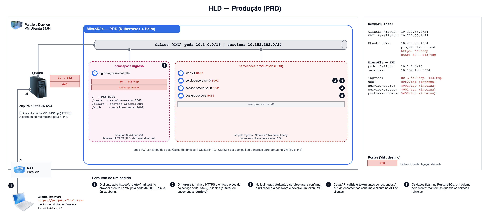
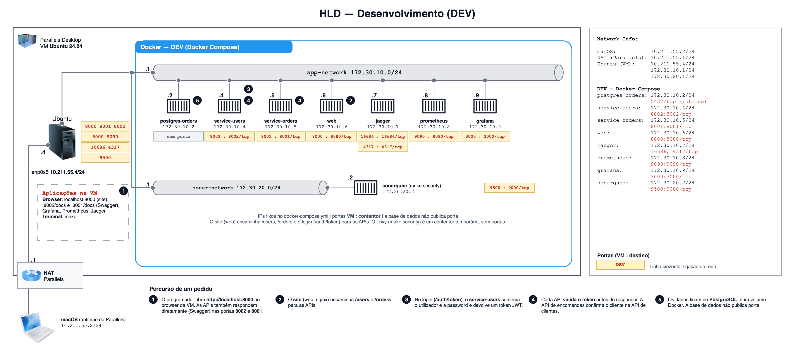
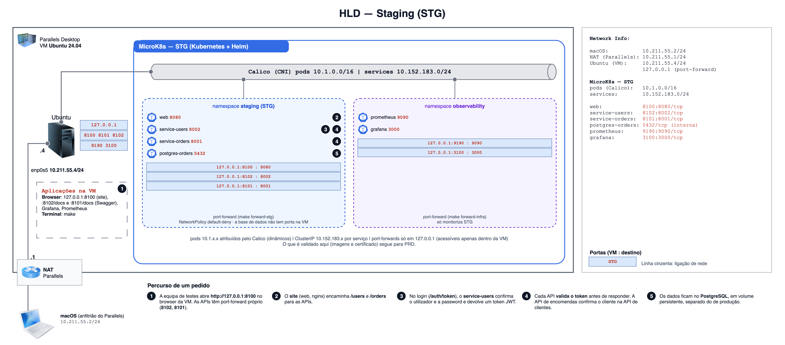

# Processo de implementação, decisões de design, ferramentas e bibliotecas Python

Plataforma de Gestão de Clientes e Encomendas — Projeto Final de DevOps — Daniel Almeida, Tokio School

## 1. Introdução

O presente documento descreve o processo de implementação da Plataforma de Gestão de Clientes e Encomendas, fundamenta as principais decisões de design e identifica as ferramentas e as bibliotecas Python utilizadas.

A plataforma permite a uma organização registar os seus clientes e as respetivas encomendas, através de um site de gestão destinado aos funcionários e de uma API REST, com respostas em JSON, destinada à integração com outras aplicações. A solução é entregue de forma automática em três ambientes — desenvolvimento (DEV), testes (STG) e produção (PRD) — e inclui autenticação centralizada e monitorização.

## 2. Arquitetura da solução

A solução é composta por três serviços aplicacionais executados em contentores — o site de gestão, a API de clientes e a API de encomendas —, por uma base de dados PostgreSQL e pelas ferramentas de monitorização Prometheus e Grafana (DEV e STG) e Jaeger (só DEV). PRD não tem observabilidade. A API de clientes trata também do login e emite os *tokens* JWT que as duas APIs validam. A API de encomendas comunica com a API de clientes para validar o cliente associado a cada encomenda. A análise de vulnerabilidades é feita pelo SonarQube (código), pelo pip-audit (dependências Python) e pelo Trivy (dependências e imagens), fora da aplicação.

*Figura 1 — Arquitetura de alto nível do ambiente de produção.*

O HLD principal mostra o ambiente de **produção (PRD)** na perspetiva do cliente, em cinco passos numerados:

1. O cliente abre `https://projeto-final.test` no browser e entra pela porta **443** (HTTPS), a única aberta na VM. A porta 80 apenas redireciona para a 443. O nome `projeto-final.test` tem de apontar para a VM: `make run-prd` indica a entrada a criar no `/etc/hosts`.
2. O Ingress NGINX termina o HTTPS e entrega o pedido ao serviço certo: o site (`/`), a API de clientes (`/users`) ou a API de encomendas (`/orders`).
3. No login (`/auth/token`), a API de clientes confirma o utilizador e a password e devolve um token de acesso (JWT).
4. Cada API valida o token antes de responder. A API de encomendas confirma o cliente na API de clientes.
5. Os dados ficam no PostgreSQL, em volume persistente.

As APIs e a base de dados não têm porta aberta para fora, e as NetworkPolicies só permitem as ligações desenhadas. Cada ambiente tem o seu próprio HLD, todos no formato praticado nas aulas (M2-11): o servidor Ubuntu, a rede em tubo com a sub-rede, os contentores ou *pods* ligados à rede, as etiquetas de portas (VM : destino), a NAT e o painel *Network Info*. As portas de DEV estão a amarelo, as de STG a azul e as de PRD a vermelho, e os números 1 a 5 marcam nas peças os passos do percurso.

**DEV — Docker Compose** (acesso por `localhost`; rede `app-network` `172.30.10.0/24`, SonarQube na `sonar-network` `172.30.20.0/24`):

**STG — Kubernetes (MicroK8s)** (acesso só dentro da VM, por *port-forward* em `127.0.0.1`):

Tudo corre numa VM Ubuntu 24.04 (`10.211.55.4`). Os ficheiros `.drawio.png` são ao mesmo tempo a imagem e o diagrama editável (abrem-se diretamente no draw.io).

Decisões de arquitetura e de rede (Módulo 2):

- **Ambientes separados:** DEV em Docker Compose; STG e PRD em *namespaces* próprios do MicroK8s, cada um com NetworkPolicies de bloqueio por omissão. Só PRD tem dados reais.
- **Disponibilidade:** um único nó (VM), sem multi-AZ. A disponibilidade é garantida ao nível dos pods (réplicas, HPA, PodDisruptionBudget, health-checks).
- **Endereçamento IP:** só intervalos privados RFC 1918, sem sobreposição entre redes.
- **Entrada (Ingress):** em PRD, ponto de entrada único pelo Ingress em HTTPS 443 (80 redireciona para 443). STG só é acessível por *port-forward* em `127.0.0.1`.
- **Saída (Egress):** a VM sai para a Internet pela NAT do Parallels (GitHub, GHCR, Docker Hub, PyPI). Os pods de PRD não têm saída para a Internet.
- **Segmentação e microssegmentação:** apresentação, aplicação e dados separados por NetworkPolicies (só passam os fluxos necessários, porta a porta), e cada pedido às APIs valida o token JWT e o *scope* (Zero Trust).

## 3. Processo de implementação

A implementação decorreu de forma incremental. Cada fase foi validada antes do início da seguinte, de modo a que os problemas fossem detetados na fase em que tiveram origem.

| Fase | Trabalho realizado |
|---|---|
| 1. Aplicação | Desenvolvimento de dois microsserviços em Python, com o FastAPI: clientes e encomendas, com as operações de criação, consulta, edição e eliminação. Persistência dos dados em PostgreSQL. |
| 2. Segurança da API | Autenticação por *token* JWT (HS256) emitido pela API de clientes. Cada pedido é validado quanto à assinatura, à validade e à permissão (*scope*) exigida pela operação. Numa primeira versão usou-se o Keycloak; foi substituído por ser pesado demais para uma VM pequena (ver secção 4). |
| 3. Contentorização | Um Dockerfile por serviço. As imagens incluem apenas as dependências de execução e são executadas por um utilizador sem privilégios. |
| 4. Ambiente DEV | Ambiente local em Docker Compose, com todos os serviços, para desenvolvimento, testes unitários e testes de vulnerabilidades do código. |
| 5. Ambientes STG e PRD | Kubernetes (MicroK8s) com um único *chart* Helm e um ficheiro de valores por ambiente. Em PRD: 1 réplica de cada serviço, escalonamento automático das APIs por CPU (até 3) e ponto de entrada único em HTTPS. |
| 6. Observabilidade | Em DEV e STG, métricas no Prometheus e painéis e alertas no Grafana; em DEV, também rastreio distribuído dos pedidos no Jaeger, através do OpenTelemetry. PRD não tem observabilidade. |
| 7. Site de gestão | *Backoffice* web que permite aos funcionários gerir clientes e encomendas sem recorrer diretamente à API. |
| 8. Entrega contínua | Pipeline em GitHub Actions: análise de vulnerabilidades (código, dependências e imagens), construção das imagens, testes e *deploy*, segundo a ordem `dev`, `stg` e `main`. |
| 9. Consolidação | Separação estrita entre STG (onde tudo é construído, gerado e validado) e PRD (onde apenas se sobe o ambiente), limpeza integral dos ambientes e elaboração da documentação. |
| 10. Segurança e portabilidade | Resolução de todas as vulnerabilidades, sem exceções: bibliotecas atualizadas e imagens em Alpine. Correção dos 25 *issues* do SonarQube. Testes de vulnerabilidades em `tests/security`, com resultados documentados. Verificação dos pré-requisitos e permissões da máquina (`make check`) e testes sem o ambiente a correr, para poupar memória. |

## 4. Decisões de design

| Decisão | Fundamentação |
|---|---|
| Três ambientes com funções distintas | DEV destina-se ao desenvolvimento, STG à validação e PRD à exploração. Os testes unitários e de vulnerabilidades são executados em DEV, e os de integração, *smoke* e de vulnerabilidades em STG; em PRD não são executados testes, sendo a disponibilidade assegurada pelos *health-checks* do Kubernetes. Cada ambiente sobe sozinho e nenhum precisa de outro em cima: PRD não precisa de STG nem da monitorização, e `make stop-stg stop-infra` liberta essa memória antes de `make run-prd`. Os *builds* e os testes de segurança só usam o Docker, sem nenhum ambiente a correr: `make test-dev` para DEV antes de correr. |
| PRD independente e leve | PRD sobe sozinho (`make build-prd` → `make run-prd`): no cluster ficam só a aplicação, o Ingress controller e os componentes do MicroK8s. O `run-prd` ativa os *addons* necessários, gera o certificado TLS e carrega as imagens. As imagens podem também vir de STG: depois de os testes passarem, `make test-stg` promove-as para PRD sem novo *build*, para correr em produção exatamente o que foi validado. Numa versão anterior, PRD dependia de STG (imagens, certificado e Ingress eram preparados aí), o que obrigava a ter STG e a monitorização em memória ao mesmo tempo que PRD. |
| OpenTelemetry apenas em DEV | O rastreio distribuído serve o diagnóstico e a resolução de problemas durante o desenvolvimento. As bibliotecas estão num ficheiro próprio (`requirements-tracing.txt`), instalado só nas imagens de DEV. A imagem de STG, que é a mesma que segue para PRD, não as inclui. Assim, PRD executa exatamente o que foi validado e não tem código de diagnóstico nem o custo de processamento e o volume de dados associados. A monitorização de STG faz-se por métricas (Prometheus) e alertas (Grafana). |
| Sem observabilidade em PRD | A observabilidade (métricas e rastreio) serve o diagnóstico e a validação, que decorrem em DEV e STG. Em PRD não se fazem testes nem diagnóstico: o Prometheus não recolhe métricas de `production` (`observability.enableMetrics: false` em `values-production.yaml`, sem regra de NetworkPolicy para o *namespace* `observability`), e o pipeline de `main` não aplica nem consulta a monitorização. A disponibilidade em PRD é assegurada pelos *health-checks* do Kubernetes e pelo escalonamento automático. |
| Escalonamento só por CPU, sem reagir ao arranque | Sem carga, PRD corre 1 *pod* de cada serviço. O HPA das APIs (até 3 réplicas) usa só o CPU: a memória de um serviço Python não desce ao acrescentar réplicas. Só escala se a carga durar 2 minutos, porque o pico de CPU do arranque (mais de 80 % do pedido) criava uma 2.ª réplica do `service-orders` sem necessidade. |
| Testes de vulnerabilidades em várias camadas, sem exceções | O SonarQube analisa o código Python. O pip-audit e o Trivy analisam as dependências Python, e o Trivy analisa também as imagens que seguem para PRD. Os testes estão em `tests/security` e correm com `make security` (também chamado por `make test-dev`) e no pipeline. Só precisam do Docker: não é preciso nenhum ambiente nem o cluster a correr. Nenhuma vulnerabilidade é ignorada (o `.trivyignore` foi eliminado). As que existiam foram resolvidas: atualização do `starlette` e do `PyJWT`, mudança da base das imagens de Debian para Alpine (eliminou 44 vulnerabilidades HIGH do sistema operativo sem correção) e remoção do `pip` das imagens. Os resultados estão em `tests/security/RESULTADOS.md`. |
| SonarQube local, a pedido | O SonarQube corre em Docker, no *profile* `sonar` do `docker-compose.yml`, fora da rede da aplicação. Só é iniciado por `make security`, com a memória limitada a cerca de 1,5 GB, e é parado no fim da análise. Não corre em STG, onde não cabe em memória ao lado do cluster; o código é o mesmo já analisado em DEV e no pipeline. As análises ficam guardadas em volume e podem ser consultadas no painel (`make sonar-up`). |
| Portabilidade entre máquinas | O projeto é executado noutras máquinas Ubuntu, com outras permissões. `make check` verifica os programas, o acesso ao Docker sem `sudo`, as permissões de `sudo` e a memória, e indica como corrigir cada falha. O `make` pede a palavra-passe do `sudo` antes de abrir *port-forwards* e espera que fiquem ativos antes de correr os testes. Os pré-requisitos estão no README (secção 3). |
| Dependências separadas por ambiente | `requirements-prd.txt` contém apenas as dependências de execução. O OpenTelemetry está em `requirements-tracing.txt`, só para DEV. Os módulos de teste e de análise (`pytest`, `httpx`, `pysonar`, `pip-audit`) encontram-se em `requirements-stg.txt` e `requirements-dev.txt` e não são incluídos nas imagens. |
| Ponto de entrada único em HTTPS | Em PRD, um Ingress com TLS e redirecionamento de HTTP para HTTPS constitui o único acesso externo. Os serviços e as ferramentas de monitorização não são expostos. |
| Autenticação leve, sem servidor de identidade | A API de clientes emite *tokens* JWT assinados (HS256) e as duas APIs validam-nos com o mesmo segredo, guardado num Secret do Kubernetes. A versão anterior usava o Keycloak (Java): consumia 1 a 1,5 GB de memória e demorava vários minutos a arrancar, e numa VM do curso com poucos recursos o ambiente não chegava a subir. Trocá-lo tornou o projeto mais simples, leve e reprodutível, mantendo as permissões por operação (*scopes*). A API de encomendas identifica-se perante a de clientes com um *token* de serviço próprio, só com `users:read`. |
| Sub-redes fixas em DEV | A rede da aplicação (`172.30.10.0/24`) e a das ferramentas de segurança (`172.30.20.0/24`) são definidas no `docker-compose.yml`. O plano de endereçamento fica previsível e documentado no HLD, e as ferramentas de análise ficam num segmento separado da aplicação. |
| Rede restrita por omissão | As NetworkPolicies bloqueiam todo o tráfego no cluster e autorizam apenas as ligações necessárias entre componentes. |
| Isolamento por *namespace* | STG, PRD e a observabilidade residem em *namespaces* distintos; a monitorização serve apenas STG. |
| Persistência dos dados | A base de dados utiliza um volume persistente, que se mantém após o reinício dos serviços e a paragem do ambiente. Apenas os comandos de limpeza o eliminam. |
| *Chart* Helm único | O mesmo *chart* serve STG e PRD; as diferenças (réplicas, HTTPS, rastreio, recursos) residem nos ficheiros de valores. |
| Makefile como ponto de entrada | Os mesmos comandos em todos os ambientes (`build`, `run`, `test`, `clean`). O Makefile deteta o cluster e a variante do Docker Compose disponíveis e arranca o MicroK8s quando este se encontra parado. |
| Limpeza integral | `make clean` remove os recursos do projeto no cluster (aplicação, monitorização, Ingress controller e imagens), desativa os *addons* que o projeto ativou (DNS, armazenamento, métricas, Ingress) e apaga tudo o que resta em todos os *namespaces*, incluindo a rede do cluster (`kubectl delete all --all --all-namespaces`), e as imagens sem uso (`ctr images prune --all`). Como o MicroK8s não volta a criar a rede (Calico) sozinho, o `run-stg` ou `run-prd` seguinte repõe-na automaticamente. Aplica ainda a limpeza Docker completa adotada nas aulas (`compose down -v --rmi all`, `system prune -af --volumes`, `volume`, `network` e `builder prune`), bem como o ambiente virtual, os certificados, os ficheiros de acesso ao cluster e a entrada no `/etc/hosts`. |
| Site de gestão sem *framework* | HTML, CSS e JavaScript servidos por nginx. É suficiente para as operações necessárias e não introduz etapas de construção nem dependências adicionais. |

## 5. Ferramentas utilizadas

| Ferramenta | Utilização |
|---|---|
| Python 3.12 | Linguagem dos microsserviços e dos testes |
| Docker e Docker Compose | Construção das imagens e ambiente DEV |
| Kubernetes (MicroK8s) | Orquestração dos ambientes STG e PRD |
| Helm | Instalação e atualização da aplicação no cluster |
| PostgreSQL 16 | Base de dados de clientes e encomendas |
| JWT (PyJWT, HS256) | Autenticação e autorização: login na API de clientes e validação dos *tokens* nas duas APIs |
| nginx | Servidor do site de gestão e Ingress HTTPS em PRD |
| Prometheus e Grafana | Métricas, painéis e alertas (DEV e STG) |
| Jaeger e OpenTelemetry | Rastreio distribuído (DEV) |
| SonarQube Community 26.9 | Testes de vulnerabilidades do código Python (*quality gate* de segurança) |
| Trivy 0.76.1 | Análise de vulnerabilidades das dependências e das imagens (corre num contentor) |
| pip-audit | Análise de vulnerabilidades das dependências Python |
| Alpine Linux | Base das imagens das API (`python:3.12-alpine3.24`) e do site de gestão |
| GitHub Actions | Pipeline de integração e entrega contínuas |
| GitHub Container Registry | Registo das imagens |
| Make | Ponto de entrada único para todos os ambientes |
| Git e GitHub | Controlo de versões, com os ramos `dev`, `stg` e `main` |
| draw.io | Diagrama de arquitetura |

## 6. Bibliotecas Python

### 6.1 Execução (`requirements-prd.txt`, imagens de STG e PRD)

| Biblioteca | Versão | Finalidade |
|---|---|---|
| fastapi | 0.141.1 | *Framework* web das duas API (a versão mais recente sem dependência do OpenTelemetry) |
| starlette | 1.10.0 | Base do FastAPI (corrige as CVE-2026-48818 e CVE-2026-54283) |
| uvicorn | 0.30.6 | Servidor de aplicações (ASGI) |
| pydantic | 2.12.5 | Validação dos dados recebidos |
| sqlalchemy | 2.0.35 | Acesso à base de dados (ORM) |
| psycopg2-binary | 2.9.11 | Ligação ao PostgreSQL |
| pyjwt | 2.15.1 | Emissão (login) e validação dos *tokens* de autenticação (HS256) |
| httpx | 0.27.2 | Comunicação entre a API de encomendas e a API de clientes |
| prometheus-fastapi-instrumentator | 8.1.0 | Exposição de métricas para o Prometheus |

### 6.2 Rastreio (`requirements-tracing.txt`, só DEV)

| Biblioteca | Versão | Finalidade |
|---|---|---|
| opentelemetry-api, -sdk e -exporter-otlp-proto-grpc | 1.45.1 | Geração e envio de *traces* para o Jaeger |
| opentelemetry-instrumentation-fastapi e -httpx | 0.66b1 | Rastreio automático dos pedidos |

### 6.3 Testes e análise (`requirements-stg.txt` e `requirements-dev.txt`)

| Biblioteca | Versão | Finalidade |
|---|---|---|
| pytest | 9.1.1 | Testes unitários, de integração, *smoke* e de vulnerabilidades |
| httpx | 0.27.2 | Cliente HTTP utilizado pelos testes |
| pysonar | 1.9.0.5762 | Envio do código Python para análise no SonarQube |
| pip-audit | 2.10.1 | Análise de vulnerabilidades das dependências Python |

## 7. Validação

| Tipo | Ferramenta | Ambiente | N.º | Âmbito |
|---|---|---|---|---|
| Unitários | pytest | DEV | 46 | Cada serviço isoladamente: operações, validação de dados, login, autenticação e permissões |
| Vulnerabilidades do código | SonarQube | DEV e pipeline | — | Código das duas API, dos *scripts* e dos testes: 0 *issues* (eram 25) |
| Vulnerabilidades das dependências | pip-audit e Trivy | `make security` e pipeline | 5 | Dependências Python de cada serviço: 0 vulnerabilidades |
| Vulnerabilidades das imagens | Trivy | `make security` e pipeline | 3 | Imagens construídas (`stg` e `main`): 0 vulnerabilidades, em todas as severidades |
| Integração | pytest | STG | 12 | Ciclo completo com *tokens* reais (login), comunicação entre serviços e acesso pelo site de gestão |
| *Smoke* | pytest | STG | 3 | Disponibilidade dos três serviços após o *deploy* |

No pipeline, os testes unitários correm no ramo `dev` e os testes de integração e *smoke* no ramo `stg`, contra o cluster; se forem aprovados, o pipeline de `stg` prepara PRD. Os resultados detalhados dos testes de vulnerabilidades estão em `tests/security/RESULTADOS.md`. No ramo `main` não são executados testes funcionais: repete-se apenas a análise de vulnerabilidades, a imagem validada em STG é promovida sem nova construção e, após aprovação manual, instalada em PRD.

## 8. Limitações e evolução

A configuração entregue destina-se a demonstração e avaliação. Para uma utilização com dados reais, recomenda-se a substituição das credenciais de demonstração e do certificado autoassinado, a definição de várias contas com perfis de acesso diferenciados (na base de dados ou num servidor de identidade), a limitação de tentativas de login e a utilização de um cluster com vários nós, com cópias de segurança da base de dados.
